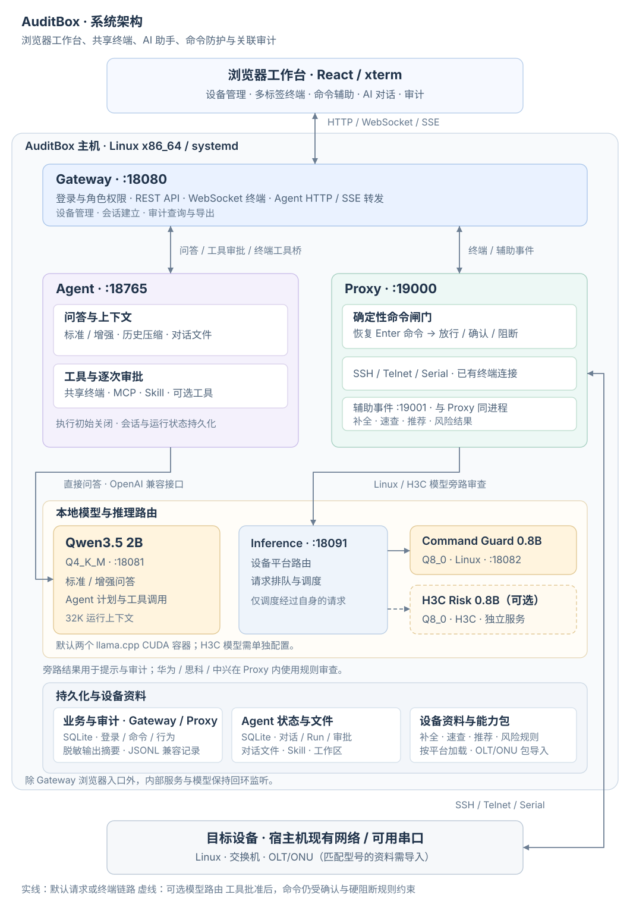

# AuditBox

**面向 Linux 服务器和网络设备的本地智能运维与审计工作台。**

[](LICENSE)
[](models/README.md)

AuditBox 将设备终端、命令资料、AI 助手和操作审计放在同一个浏览器工作台里。它辅助运维人员操作设备，也帮助管理者防范高危操作，并追溯操作经过。

[项目用途](#项目用途) · [主要功能](#主要功能) · [QuickStart](#quickstart) · [应用场景](#应用场景) · [部署与模型](#部署与模型) · [设计与架构](#设计与架构) · [文档与源码](#文档与源码)

## 项目用途

终端运维中的误操作和故意执行的破坏性命令，都可能损坏系统、数据或影响业务。AuditBox 为运维人员提供命令参考和 AI 分析，并在命令提交时按规则要求确认或直接阻断，用于防范高危操作。

审计记录按登录账号、时间和目标设备关联操作过程。管理者可以追溯运维账号在哪台设备上提交了哪些命令，哪些操作被确认、取消或阻断，以及命令是否实际下发、设备返回了什么。

## 主要功能

- **设备连接与命令辅助**：通过 SSH、Telnet 或主机上的可用串口连接设备，使用多标签终端。命令辅助提供前缀补全、速查卡片、参数模板和下一步检查推荐，资料按设备平台组织。
- **AI 问答与执行**：解释命令和设备输出，整理排查步骤，提供标准问答与增强问答。支持为当前对话上传 Markdown、TXT、DOCX；开启 Agent 执行后，助手可通过经审批的终端操作继续任务。
- **高危命令防护**：在命令下发前按规则要求确认或直接阻断。例如，Linux 规则会阻断 `rm -rf /*` 这类递归强制删除根目录内容的命令。人工输入和 Agent 写入终端的命令经过同一套检查；旁路审查提供补充风险提示，供运维人员核对。
- **审计与追溯**：记录登录账号、操作时间、目标设备、命令、确认与阻断情况，以及实际下发状态和脱敏后的有限输出摘要。Agent 操作还关联原问题、对话和运行记录，便于回查一次任务的操作经过。

助手的执行开关初始关闭。开启后，可按需加载本地 Skill、接入 MCP 外部工具，或启用代码、Docker、SQL 和文件生成工具；MCP 与这几类工具调用前需要批准。知识库默认关闭，可按需配置，具体见 [Agent 说明](agent/README.md)。

## QuickStart

> [!NOTE]
> QuickStart 提供终端、命令辅助、执行确认与审计，无需 GPU 或模型。AI 问答和模型审查按[部署与模型](#部署与模型)另行启用。

准备好 Git、Bash、uv、Python 3.11，以及 Node.js 20.19+ 或 22.12+，在终端执行：

```bash
git clone https://github.com/Motannier/auditbox.git
cd auditbox
./scripts/quickstart.sh
```

脚本按锁文件安装依赖、构建网页、初始化配置，并启动 Proxy 和 Gateway。浏览器打开 **http://127.0.0.1:18080**。

### 登录并连接设备

1. 在 `box/.env` 中查看 `AUDITBOX_ADMIN_PASSWORD`，使用账号 `opsadmin` 登录。
2. 新建设备连接，选择对应平台，填写可达目标的 IPv4 地址、SSH 端口和登录凭据。
3. 打开终端，执行一条只读命令，例如 Linux 上的 `df -h`，查看输出、命令辅助和操作记录。

查看和导出审计使用 `superadmin`，密码对应 `AUDITBOX_SUPER_ADMIN_PASSWORD`。首次配置会生成随机密码和登录签名密钥，写入权限为 `0600` 的 `box/.env`；后续启动保留已有配置，脚本不会打印密码。核心数据与日志位于 `box/data/`。

审计按登录账号归属操作；多人共用账号时，无法仅凭记录区分具体操作人。

按 **Ctrl+C** 停止本次启动的服务。下次使用 `./scripts/quickstart.sh --start-only` 直接启动。

<details>
<summary>其他启动选项与远程访问</summary>

只安装依赖、构建与初始化配置，使用 `./scripts/quickstart.sh --build-only`。需要 Python 3.10 时，可设置 `PYTHON_VERSION=3.10` 运行同一脚本。

QuickStart 默认只监听本机。如果在远程主机运行，从自己的电脑建立 SSH 转发，再打开上面的浏览器地址：

```bash
ssh -L 18080:127.0.0.1:18080 user@server
```

</details>

## 应用场景

| 运维对象 | 典型工作 | 当前接入方式 |
| --- | --- | --- |
| Linux 服务器 | 检查磁盘、内存、进程、服务、日志与网络，辅助定位主机问题 | 内置 Linux 平台，可选 Linux 命令审查模型 |
| 交换机 | 巡检接口、VLAN、路由与配置，排查连通性，核对变更影响 | 内置 H3C Comware、华为 VRP、思科 IOS／IOS XE、中兴 ZXR10 平台 |
| OLT | 查看 PON 端口、ONU 注册、线路、业务和告警，辅助光接入排障 | 导入匹配厂商、型号与软件版本的命令数据包 |
| ONU／ONT | 查看用户侧链路与业务信息，核对接入参数和故障现象 | 按型号与管理接口导入资料；终端操作需要可用的 CLI |

OLT/ONU 分类和命令辅助在导入相应数据包后提供，具体支持范围以包内资料和目标设备为准。连接协议负责传输，设备平台决定使用哪些命令资料、推荐和风险规则，选择时需要核对实际型号与软件版本。

设备能力包采用纯数据格式，超级管理员可在没有活动终端时导入。应用会检查包的结构、引用和 SHA-256，相关实现见[后端说明](box/README.md)与[命令数据包](box/auditbox/command_packages.py)。

## 部署与模型

### 在服务器上常驻运行

仓库提供 systemd 安装器。默认完整部署需要 Linux x86_64、systemd、Python 3.10／3.11、uv、前端构建工具，以及 Docker Compose 和 NVIDIA GPU 运行环境。

先准备下表中的两个默认模型，并按 [Compose 配置](deploy/server/models.compose.yaml)准备固定版本镜像。首次安装时，在源码目录执行：

```bash
./scripts/quickstart.sh --build-only
sudo ./deploy/server/install.sh --address '<server-ip>' --models '/path/to/models' --uv "$(command -v uv)"
sudo systemctl start auditbox-server-{proxy,gateway,models,inference,agent}
```

将 `<server-ip>` 与 `/path/to/models` 替换为实际 IPv4 地址和模型目录。安装器创建应用账号、独立 Python 环境和 systemd 服务，并为新环境生成登录凭据。浏览器访问 `http://<server-ip>:18080`，初始密码保存在仅 root 可读的 `/etc/auditbox-server/initial-credentials.json`。

已有实例按[服务器部署文档](deploy/server/README.md)进行备份、升级、健康检查与回退。配置和业务数据独立于应用版本保存；回退应用前，需要核对当前数据库与旧版本的兼容性。

### 模型选择与 AI 配置

问答与命令审查可以分别启用。默认部署使用 MiniCPM5 和 Command Guard，H3C Risk 按需配置：

| 模型 | 用途 | 配置 |
| --- | --- | --- |
| [MiniCPM5 2B](https://huggingface.co/openbmb/MiniCPM5-2B-GGUF) | 标准／增强问答、Agent 计划与工具调用 | 上游 Q4_K_M 制品，默认问答模型 |
| [Command Guard 0.8B](https://huggingface.co/Motanni/auditbox-command-guard-0.8b-gguf) | Linux 近期命令与上下文风险审查 | 基于 Qwen3.5-0.8B 微调，Q8_0，默认审查模型 |
| [H3C Risk 0.8B](https://huggingface.co/Motanni/auditbox-h3c-risk-0.8b-gguf) | H3C Comware 命令风险审查 | 基于 Qwen3.5-0.8B 微调，Q8_0，需单独配置端点与路由 |

两个 0.8B 模型采用 GPL-3.0-only，保留基础模型的 Apache 2.0 许可与归属说明。下载与校验步骤、模型卡见[模型说明](models/README.md)，固定 revision、文件大小和 SHA-256 见[模型清单](models/manifest.json)。

在核心工作台上增加问答，按 [Agent 运行说明](agent/README.md#运行与开发)配置问答端点并启动 Agent。Linux 模型审查还需启动 Inference、配置审查端点，将 `box/.env` 中的 `AUDITBOX_HISTORY_REVIEW_ENABLED` 设为 `true` 后重启 Proxy。在问答模式中，分析设备现状需要提供当前输出。

默认模型通过本机的 llama.cpp CUDA 容器运行，也可改用 Ollama 或其他 OpenAI 兼容端点。替换时需要核对模型别名、聊天模板、工具调用支持和上下文预算；使用外部端点会把请求中的上下文发送到该服务。

## 设计与架构

操作员通过浏览器访问 AuditBox，AuditBox 主机通过现有网络或可用串口连接目标设备。设备账号的权限和原生 CLI 决定可执行的操作。



Gateway 负责登录、浏览器接口和终端会话；Proxy 持有设备连接，处理命令控制与审计。Agent 管理对话、上下文和工具，直接调用问答模型；Inference 为旁路审查提供模型路由与请求调度。业务与审计使用 SQLite，Agent 单独保存会话、运行和文件。

- **保留原生终端交互。** Proxy 在 Enter 提交时恢复当前命令并检查规则，Tab 补全、历史导航、行编辑和分页仍交给目标 CLI。
- **人工与助手共用连接。** Agent 通过 Gateway 操作已有终端，无需持有目标 SSH 密码或另建连接。每次终端写入和 Ctrl+C 都需审批，获准的命令继续经过命令闸门；人工输入可以中断正在等待结果的操作。待审批参数与运行检查点会保存，详见[终端工具设计](agent/docs/TERMINAL_TOOL_DESIGN.md)。
- **规则控制下发，模型补充风险建议。** 确认只对当前命令生效，内容改变后重新检查，硬阻断不能通过普通确认解除。未命中规则的命令可能按未知项放行，覆盖范围需要结合实际设备核对。
- **按实际结果记录。** 审计区分建议、审批、命令下发和执行结果。缺少可靠退出状态时，结果保留为未知，详见[关联审计设计](docs/linked-audit.md)。

浏览器入口由 Gateway 鉴权，内部服务与模型须保持回环监听。Agent 没有独立登录鉴权，当前按配置中的固定本地用户保存会话。端口和数据路径见[系统架构](docs/ARCHITECTURE.md)，部署访问范围与凭据管理见[安全说明](SECURITY.md)。

## 文档与源码

```text
auditbox/
├── box/                 # Gateway、协议代理、命令辅助与审计
├── agent/               # 对话、上下文、审批与工具
├── web/                 # React / xterm 浏览器工作台
├── models/              # 模型来源、模型卡与校验清单
├── deploy/server/       # systemd 安装器与模型运行配置
├── scripts/             # 构建、配置与启动入口
├── tools/               # 模型校验与设备数据工具
└── docs/                # 架构与关联审计设计
```

后端使用 Python、FastAPI、Paramiko 与 pyserial，Agent 基于 Agno，两者维护独立 Python 环境和锁文件。阅读实现可从 [Gateway](box/auditbox/gateway/app.py)、[命令闸门](box/auditbox/relay/command_gate.py)、[Agent 运行](agent/src/auditbox_agent/runtime.py)和[上下文管理](agent/src/auditbox_agent/context_manager.py)入手。

[后端模块](box/README.md) · [Agent 配置与扩展](agent/README.md) · [开发与贡献](CONTRIBUTING.md) · [变更记录](CHANGELOG.md) · [第三方来源与许可](THIRD_PARTY_NOTICES.md)

代码采用 [GPL-3.0-only](LICENSE)，第三方依赖、Skill、模型与素材适用各自的许可。
