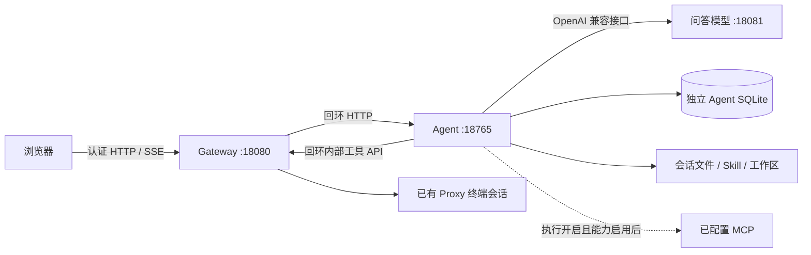

# 服务器版 Agent 架构

服务器部署中，Agent 由 systemd 单独管理，使用独立 Python 环境和 SQLite。浏览器通过 Gateway 登录后访问。

Agent API 无独立登录鉴权，18765 仅监听 `127.0.0.1`。Gateway 负责浏览器认证，Agent 使用固定本地用户保存会话，采用单用户模型。

标准与增强模式共用 Qwen3.5 2B 和 32K 上下文，通过请求中的思考参数区分。服务器配置中，Agent 直接访问 18081 问答端点，不经过 Inference 队列。

执行总开关初始关闭；开启后，Agent 加载已启用的工具和能力。终端写入须逐次审批，通过 Gateway 复用已有 Proxy 会话；Agent 不持有目标 SSH 密码。会话文件读取无需逐次审批。

会话、运行、审批和元数据保存在独立 SQLite，文件区、Skill 和工作区保存在状态目录。知识库默认关闭，ChromaDB 和 Office 扩展按需安装。

完整流程见 [服务器架构](../../docs/ARCHITECTURE.md)，终端工具边界见 [终端工具说明](TERMINAL_TOOL_DESIGN.md)。
