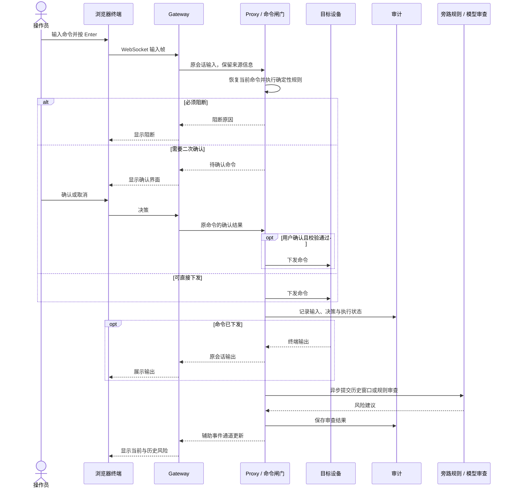
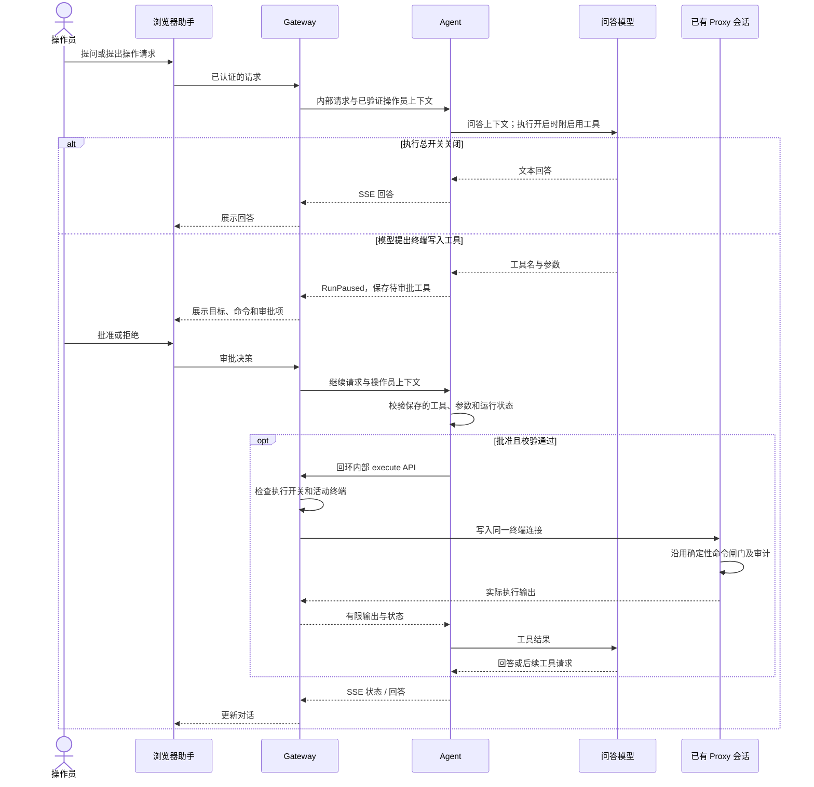
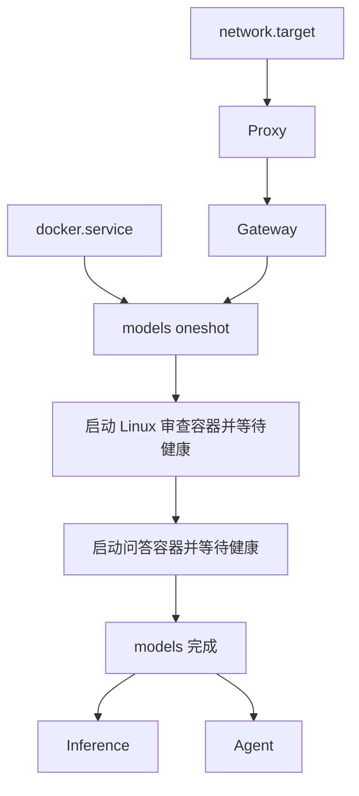

# AuditBox 系统架构

AuditBox 的终端命令与助手操作共用设备连接、命令检查和审计链路，问答与旁路审查各自调用模型服务。首次运行见 [QuickStart](../README.md#quickstart)，安装与维护见 [部署说明](../deploy/server/README.md)。

## 服务如何配合

Gateway 提供登录、网页和终端会话；Proxy 持有设备连接，处理命令检查与审计。Agent 管理问答、上下文和工具审批，直接访问问答模型；Inference 为旁路审查提供模型路由与调度。

浏览器经 Gateway 访问工作台，AuditBox 主机使用现有网络或可用串口连接设备。设备平台决定命令资料和规则；OLT/ONU 的具体型号资料需要额外导入，覆盖范围见 [应用场景](../README.md#应用场景)。串口连接取决于宿主机设备和服务账号权限。

QuickStart 只运行 Gateway 和 Proxy。下文端口表与资源配置以完整的 systemd 部署为准，由 [安装器](../deploy/server/install.py) 生成。

## 端口与访问范围

| systemd 服务或容器 | 地址 | 责任 |
| --- | --- | --- |
| `auditbox-server-gateway` | `127.0.0.1` 与安装参数中的服务器 IP，18080 | 浏览器入口、登录、静态资源、HTTP/WebSocket 与 Agent 转发 |
| `auditbox-server-proxy` | `127.0.0.1:19000`，辅助事件 `19001` | 连接目标、输入恢复、命令闸门和审计 |
| `auditbox-server-inference` | `127.0.0.1:18091` | 设备模型路由和经此服务的推理请求调度 |
| `auditbox-server-agent` | `127.0.0.1:18765` | Agno 问答、上下文、审批与能力管理 |
| `auditbox-assistant` 容器 | 宿主机 `127.0.0.1:18081` → 容器 8080 | Qwen3.5 2B、32K 上下文 |
| `auditbox-linux-audit` 容器 | 宿主机 `127.0.0.1:18082` → 容器 8080 | command-guard、10240 上下文 |
| `auditbox-server-models` | 无监听端口 | oneshot，依次启动两个模型并等待健康 |

Gateway 的绑定地址由 `AUDITBOX_GATEWAY_HOSTS` 指定。安装器配置回环与指定服务器 IP 双监听，其余进程与模型端口保持回环。Agent API 无独立登录鉴权，浏览器请求须经 Gateway 认证后转发；内部工具 API 检查调用方是否来自本机。

Proxy 的 19001 事件监听器与 19000 代理运行在同一进程中。Inference 还提供 assistant 路由，但默认 Agent 直接访问 18081；Inference 的互斥、问答优先和抢占调度仅作用于经过它的请求。

## 人工命令怎样检查和记录

命令在 Enter 提交时进入确定性规则检查。确认只对当前命令生效；硬阻断不能通过普通确认解除，未命中规则的命令可能按未知项放行。设备原生的行编辑、补全和分页交互仍由设备 CLI 处理。

旁路审查异步提供风险建议与审计证据，不改变命令闸门的决定。[review_result.py](../box/auditbox/security/review_result.py) 将兼容字段 `lock` / `locked` 固定为 false。不同平台的规则与模型分工见 [旁路审查说明](../box/auditbox/security/SWITCH_SIDE_REVIEW.md)。

## Agent 怎样使用已有终端

执行总开关初始关闭，后续以 SQLite 保存的用户设置为准。批准只对已保存的待审批工具生效；继续请求会校验工具名称和参数，并仅采纳批准或拒绝决定。

终端写入复用 Gateway 已持有的连接，Agent 不持有目标密码，也不另建 SSH 会话。工具批准后，命令仍经过同一命令闸门：需要确认的命令另行确认，硬阻断命令拒绝下发。终端读取与会话文件读取无需逐次审批；其他工具按相应能力的策略执行。

Agent 当前使用固定本地用户保存会话，不按浏览器登录账号隔离对话和文件。已验证的操作员账号用于关联终端操作审计。审批参数、人工介入和返回状态见 [终端工具设计](../agent/docs/TERMINAL_TOOL_DESIGN.md)。

## 启动顺序与资源

systemd 的依赖关系安排启动顺序；应用进程成功启动不代表问答已经可用，仍需检查模型与服务健康端点。模型启动器先等待 Linux 审查模型健康，再启动问答模型。

四个应用进程使用 `auditbox-server` 系统账号，归入独立应用 slice，合计限制为 2 个 CPU 核额度和 2 GiB 主内存。两个模型容器另设 CPU、主内存限制，共享 NVIDIA GPU，显存与算力未作硬件隔离。镜像按摘要固定，模型目录只读挂载，模型 Compose 不向应用挂载 Docker socket。

应用沿用宿主机网络和时间配置，服务器安装器关闭浏览器校时、网口修改及 Guardian 准入，不安装板端网络助手。

## 配置与数据保存在哪里

| 路径 | 内容 | 管理与升级方式 |
| --- | --- | --- |
| `/opt/auditbox-server/releases/<release>` | 应用源码和前端 `dist` | 作为版本快照保存 |
| `/opt/auditbox-server/current` | 当前 release 符号链接 | 经验证后切换 |
| `/opt/auditbox-server/releases/<release>/box/.venv`、`agent/.venv` | 当前 release 的两组独立 Python 环境 | 分别由锁文件安装；随 `current` 一起切换 |
| `/etc/auditbox-server/auditbox.env` | 环境配置与密钥 | 新环境独立生成，升级保留 |
| `/etc/auditbox-server/initial-credentials.json` | 首次随机账号凭据 | 仅 root 可读 |
| `/var/lib/auditbox-server/` | 业务与 Agent SQLite、上传和文件区 | 不随源码复制或重置 |
| `/var/log/auditbox-server/` | JSONL 和运行日志 | 独立保存，按需备份 |
| `/opt/auditbox-server/models` | 两个 GGUF | 单独准备，按哈希核对 |
| `/opt/auditbox-server/models-runtime` | 模型 Compose 与镜像配置 | 按环境独立管理 |

业务与审计共用 SQLite，Agent 使用独立数据库。命令下发、审批与实际结果分别记录，缺少可靠退出状态时保留为未知。审计字段、输出摘要和历史格式转换见 [关联审计](linked-audit.md)。

## 代码入口

- `box/auditbox/gateway/app.py`：外部 API、WebSocket、活动终端和内部工具桥。
- `box/auditbox/relay/command_gate.py`：命令恢复、确定性确认与阻断。
- `box/auditbox/security/review_result.py`：旁路建议边界。
- `box/auditbox/audit/store.py`：关联审计与增量记录。
- `box/auditbox/inference/server.py`、`routing.py`：推理队列和设备模型路由。
- `agent/src/auditbox_agent/api.py`、`runtime.py`、`context_manager.py`：会话、审批和上下文。
- `deploy/server/install.py`、`start_models.py`、`models.compose.yaml`：部署和启动配置。
