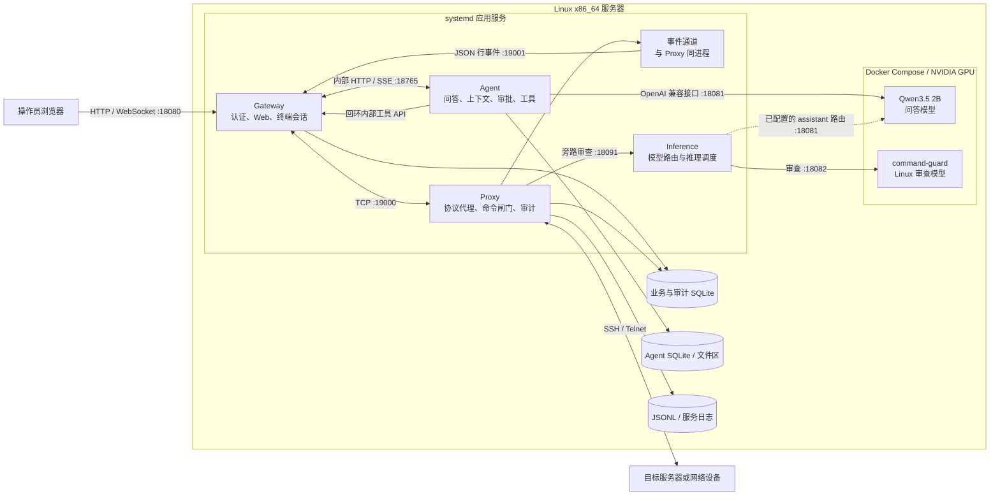
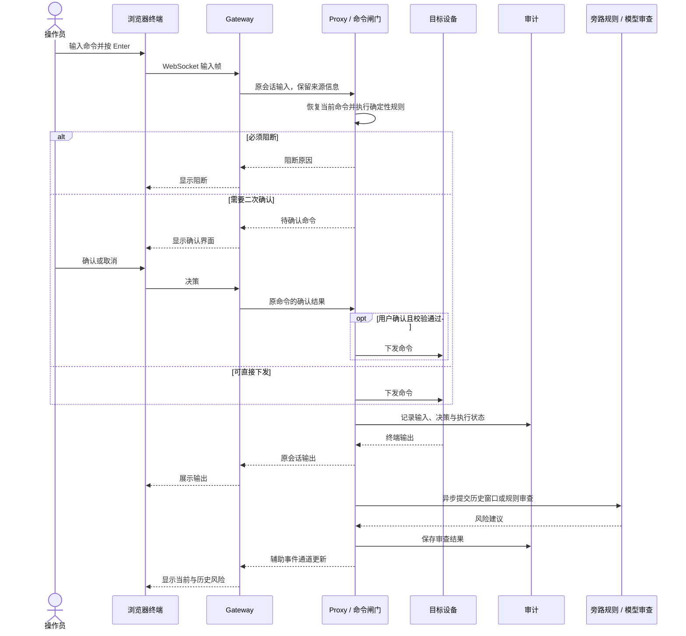
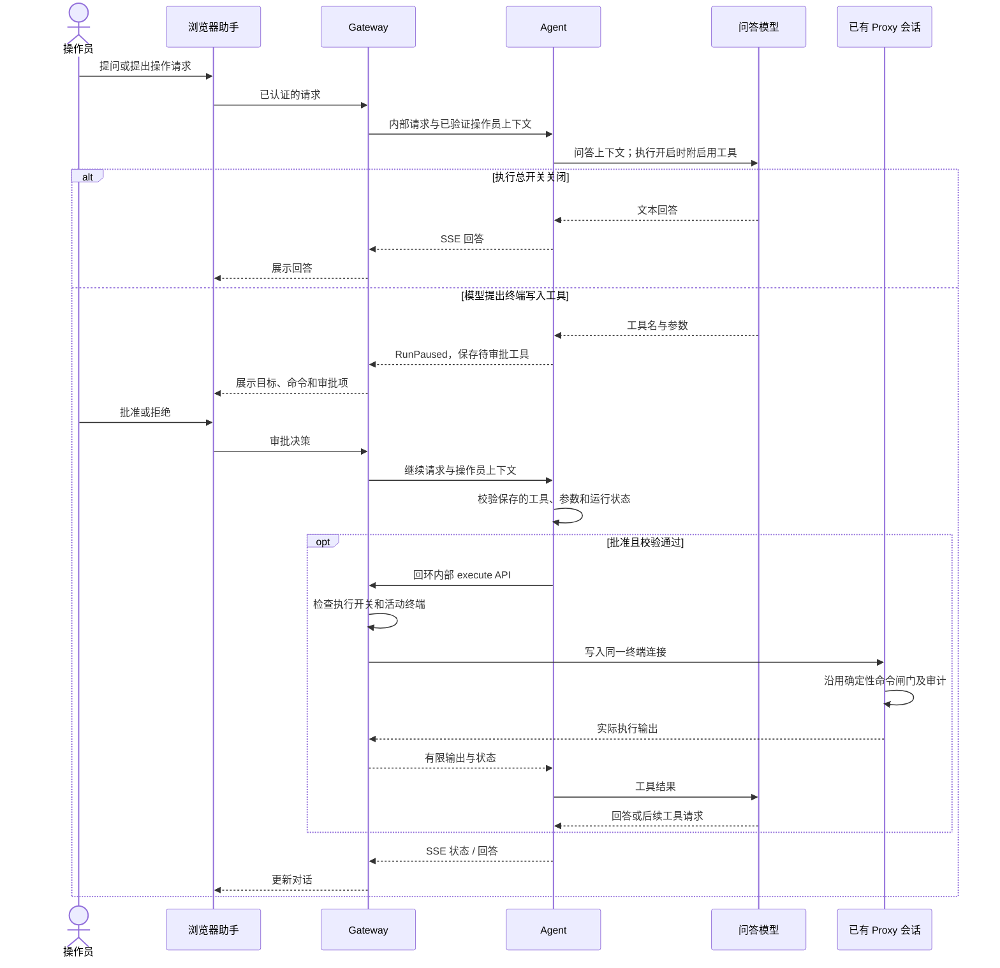
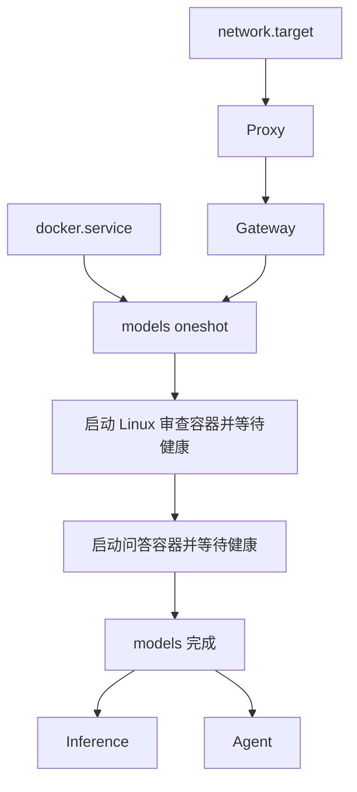

# AuditBox 服务器版架构

Gateway、Proxy、Inference 和 Agent 分别负责网页入口、终端代理、推理路由与智能助手，服务配置由 `deploy/server/install.py` 生成。

## 1. 系统与部署边界

浏览器通过服务器 IP 访问 Gateway，服务器使用现有网络连接目标设备。服务器配置不启用 USB 管理网、热点、板端网络助手、Windows Guardian 或 RK3588/NPU 服务。串口连接取决于宿主机设备和服务账号权限。

Proxy 的 19001 辅助事件监听器与 19000 代理运行在同一进程中。Agent 默认直接访问 18081 问答端点；Inference 仅对经过它的请求提供互斥、问答优先和抢占调度，模型容器仍共享 GPU。

## 2. 端口与进程

| systemd 服务或容器 | 地址 | 责任 |
| --- | --- | --- |
| `auditbox-server-gateway` | `127.0.0.1` 与安装参数中的服务器 IP，18080 | 浏览器入口、登录、静态资源、HTTP/WebSocket 与 Agent 转发 |
| `auditbox-server-proxy` | `127.0.0.1:19000`，辅助事件 `19001` | 连接目标、输入恢复、命令闸门和审计 |
| `auditbox-server-inference` | `127.0.0.1:18091` | 设备模型路由和经此服务的推理请求调度 |
| `auditbox-server-agent` | `127.0.0.1:18765` | Agno 问答、上下文、审批与能力管理 |
| `auditbox-assistant` 容器 | 宿主机 `127.0.0.1:18081` → 容器 8080 | Qwen3.5 2B、32K 上下文 |
| `auditbox-linux-audit` 容器 | 宿主机 `127.0.0.1:18082` → 容器 8080 | command-guard、10240 上下文 |
| `auditbox-server-models` | 无监听端口 | oneshot，依次启动两个模型并等待健康 |

Gateway 的绑定地址由 `AUDITBOX_GATEWAY_HOSTS` 指定。安装器配置回环与指定服务器 IP 双监听，对外开放产品入口，其余进程与模型端口保持回环。Agent API 无独立登录鉴权，浏览器请求须经 Gateway 认证后转发。Gateway 内部工具 API 检查调用方是否来自本机。

## 3. 人工命令链路

命令闸门根据确定性规则和确认状态决定是否下发。`security/review_result.py` 将旁路审查统一为风险建议，兼容字段 `lock` / `locked` 固定为 false。风险模型只提供建议和审计证据。

## 4. Agent 执行链路

执行总开关初始关闭，后续以 SQLite 保存的用户设置为准。批准只对已保存的待审批工具生效；继续请求会校验工具名称和参数，并仅采纳批准或拒绝决定。

终端写入复用 Gateway 已持有的连接，Agent 不持有目标密码，也不另建 SSH 会话。命令命中危险规则时，仍需经过命令闸门的二次确认。只读工具按对应能力的审批策略执行。

## 5. 启动与资源

四个应用进程使用 `auditbox-server` 系统账号，归入独立应用 slice。安装器限制 CPU 和主内存用量，服务无主机网络管理权限。两个模型容器共享 NVIDIA GPU，镜像按摘要固定，模型目录只读挂载，模型 Compose 不向应用挂载 Docker socket。GPU 显存与算力未作硬件隔离。

## 6. 配置与数据

| 路径 | 内容 | 管理与升级方式 |
| --- | --- | --- |
| `/opt/auditbox-server/releases/<release>` | 应用源码和前端 `dist` | 作为版本快照保存 |
| `/opt/auditbox-server/current` | 当前 release 符号链接 | 经验证后切换 |
| `/opt/auditbox-server/releases/<release>/box/.venv`、`agent/.venv` | 当前 release 的两组独立 Python 环境 | 分别由锁文件安装；随 `current` 一起切换 |
| `/etc/auditbox-server/auditbox.env` | 环境配置与密钥 | 新环境独立生成，升级保留 |
| `/etc/auditbox-server/initial-credentials.json` | 首次随机账号凭据 | root 可读，不能入库 |
| `/var/lib/auditbox-server/` | 业务与 Agent SQLite、上传和文件区 | 不随源码复制或重置 |
| `/var/log/auditbox-server/` | JSONL 和运行日志 | 不进入公开仓库 |
| `/opt/auditbox-server/models` | 两个 GGUF | 单独准备，按哈希核对 |
| `/opt/auditbox-server/models-runtime` | 模型 Compose 与镜像配置 | 按环境独立管理 |

业务与审计共用 SQLite，Agent 使用独立数据库。Gateway 将已验证的人工或 Agent 来源关联到审计记录；审计记录与模型回答分别核验。

## 7. 代码入口

- `box/auditbox/gateway/app.py`：外部 API、WebSocket、活动终端和内部工具桥。
- `box/auditbox/relay/command_gate.py`：命令恢复、确定性确认与阻断。
- `box/auditbox/security/review_result.py`：旁路建议边界。
- `box/auditbox/audit/store.py`：关联审计与增量记录。
- `box/auditbox/inference/server.py`、`routing.py`：推理队列和设备模型路由。
- `agent/src/auditbox_agent/api.py`、`runtime.py`、`context_manager.py`：会话、审批和上下文。
- `deploy/server/install.py`、`start_models.py`、`models.compose.yaml`：部署和启动配置。
